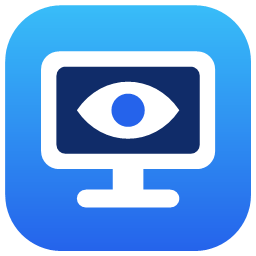

<p align="center">
  
</p>

<h1 align="center">pcStayAwake</h1>

<p align="center">
  Kleines Windows-Tray-Tool, das deinen PC – und auf Wunsch den Bildschirm – wach hält.<br>
  Kein Bildschirmschoner, kein Standby, keine automatische Sperre. Ohne Eingaben, ohne Adminrechte.
</p>

---

## Features

- **Zwei Modi**
  - **Bildschirm an + PC wach:** kein Bildschirmschoner, Bildschirm bleibt an, kein Standby
  - **Nur PC wach:** der Bildschirm darf ausgehen, der PC geht aber nicht in den Standby (Downloads, Renderings, Server …)
- **Benutzeraktivität simulieren** (optional): verhindert zusätzlich die automatische Sperre und den Status „Abwesend“ (z. B. in Teams). Der Mauszeiger bewegt sich dabei nicht.
- **Tray-Icon** mit Status: Linksklick schaltet an/aus, Rechtsklick öffnet das Menü
- **Zeitlimit:** aktiv für 15 Min. bis 8 Std., danach pausiert die App automatisch
- **Einstellungsfenster:** Modus, Autostart, Verhalten beim Start, Standard-Laufzeit, Benachrichtigungen
- **Installer:** Eintrag im Startmenü, optional Desktop-Verknüpfung und Autostart, sauber deinstallierbar über *Einstellungen › Apps*
- Winzig (~150 KB), keine Abhängigkeiten, läuft auf jedem Windows 10/11

| Icon | Bedeutung |
|:---:|---|
|  | Aktiv: Bildschirm und PC bleiben wach |
|  | Aktiv: nur der PC bleibt wach |
|  | Pausiert: Windows verhält sich normal |

## Installation

1. `pcStayAwake-Setup.exe` von der [Releases-Seite](https://github.com/theStxve/pcStayAwake/releases) herunterladen (oder selbst bauen, siehe unten)
2. Ausführen und auf **Installieren** klicken

Die App wird nur für den aktuellen Benutzer nach `%LOCALAPPDATA%\Programs\pcStayAwake` installiert, dafür sind keine Adminrechte nötig.

> **Hinweis:** Die Exe ist nicht signiert. Windows SmartScreen kann deshalb beim ersten Start warnen.
> Über *Weitere Informationen › Trotzdem ausführen* lässt sie sich starten.

**Deinstallieren:** *Einstellungen › Apps › Installierte Apps › pcStayAwake › Deinstallieren*

## Bedienung

| Aktion | Wirkung |
|---|---|
| Linksklick aufs Tray-Icon | an / aus |
| Rechtsklick aufs Tray-Icon | Menü: Status, Laufzeit, Modus, Einstellungen, Beenden |
| pcStayAwake erneut starten (z. B. über das Startmenü) | öffnet die Einstellungen der laufenden Instanz |

## Wie es funktioniert

- [`SetThreadExecutionState`](https://learn.microsoft.com/windows/win32/api/winbase/nf-winbase-setthreadexecutionstate) mit `ES_SYSTEM_REQUIRED` (und je nach Modus `ES_DISPLAY_REQUIRED`) teilt Windows mit, dass PC bzw. Bildschirm benötigt werden. Der Zustand wird alle 50 Sekunden erneuert.
- Für *Benutzeraktivität simulieren* wird per `SendInput` eine Mausbewegung um **0 Pixel** gesendet. Der Leerlauf-Timer wird dadurch zurückgesetzt, der Cursor bleibt aber stehen.
- Beim Pausieren oder Beenden wird alles zurückgesetzt, Windows verhält sich dann wieder ganz normal.

**Grenzen:** Das Zuklappen eines Laptops, der Ein/Aus-Knopf und Gruppenrichtlinien, die das Verhalten erzwingen, haben weiterhin Vorrang.

## Selbst bauen

Es muss nichts installiert werden, der C#-Compiler des .NET Framework 4.x ist in Windows enthalten.

```bat
build.bat
```

Ergebnis:

| Datei | Beschreibung |
|---|---|
| `dist\pcStayAwake.exe` | die App (läuft auch portabel ohne Installation) |
| `dist\pcStayAwake-Setup.exe` | Installer, enthält die App |

## Projektstruktur

```
src/
  pcStayAwake/   App: Tray, Einstellungsfenster, Energie-APIs, Deinstallation
  Setup/         Installer (bettet pcStayAwake.exe als Ressource ein)
  Shared/        gemeinsamer Code: Konstanten, Icon-Zeichnung, Autostart/Verknüpfungen
tools/
  IconGen.cs     erzeugt assets/app.ico und die PNGs aus dem Code
assets/          Icon, Logo, Manifest
build.bat        Build-Script
```

Einstellungen liegen unter `HKCU\Software\pcStayAwake`.

## Lizenz

[MIT](LICENSE) © theStxve
